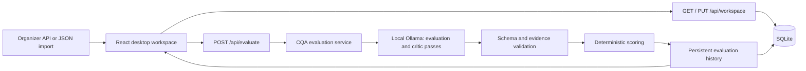

# CQA: architecture and agent responsibilities

## Product flow

A reviewer selects one dialogue, opens its analysis, checks the score and eight versioned checklist results against original messages, and can appeal a specific result. Imported dialogues stay pending until a real evaluator returns a validated result. Dataset averages never replace a dialogue score.

## Runtime boundaries

- `frontend/src/App.jsx`: navigation, user actions, import/export, criterion versions and appeals.
- `SelectionDesk.jsx`: explicit candidate selection and preview.
- `ConversationAnalysis.jsx`: transcript, chronological message navigation, historical criterion results, evidence and appeal entry point.
- `EvaluationPanel.jsx`: real API execution, error/progress/history controls. No simulated evaluator.
- `WorkspaceSync.jsx`: shared workspace API with browser-local fallback.
- `src/cqa/`: service, model provider, validation, deterministic scoring, persistence, CLI and benchmarks.
- Vercel is the requested frontend deployment target. A stateful Python API and the local model require a separately reachable persistent backend. FastAPI can also serve the built frontend for a complete same-origin local/VPS installation. Oracle work is paused. No serverless SQLite persistence or live model availability is claimed. See `docs/VERCEL_DEPLOY.md`.

## API and data invariants

`POST /api/evaluate` receives `conversation_id`, `language`, `messages`, `criteria`, `version`, and `force`. Each message retains its original `id`, `role`, `text`, and `time`. A successful result retains its model metadata, checklist version and criterion snapshot, per-criterion answers/reasons/evidence, and calculated score. Errors are shown; pending inputs do not acquire fabricated results.

The other frontend integrations are `GET /api/health`, `GET /api/history/{id}`, and `GET`/`PUT /api/workspace`. Preserve the existing revision/conflict protocol when changing persistence.

Scoring normalizes numeric scales, excludes applicable N/A weights and keeps critical errors as a separate flag. Current rule edits create a new checklist version; existing results use their original snapshot. New rules are configuration, not changes scattered across prompts and UI code. Benchmark accuracy against held-out Ground Truth independently of UI contract tests.

## Parallel ownership for this task

| Agent | Ownership | Deliverable |
| --- | --- | --- |
| Coordinator | This document, integration, git and final review | Integrated branch and reviewable commit |
| API | Read/review `src/cqa/**`, API adapters and contract | Findings on actual request/response and persistence; fixes only if a verified regression needs one |
| Site | `ConversationAnalysis.jsx`, presentation layout review | Faithful light Freedom desktop analysis, preserved backend actions |
| Tests | `frontend/tests/**`, browser QA artifacts | Smoke and API contract checks on integrated code |
| Critic | Read-only final code and screenshots | Prioritized defects and evidence, followed by fixes/retest if necessary |

One agent edits a file at a time. The coordinator owns `App.jsx` during integration; agents must message before changing shared contracts, base styles, root documentation or deployment files. Backend implementation from teammates must be retained. A separate feature branch and PR keep frontend work reviewable.

## Acceptance and review

1. Production frontend builds.
2. Desktop1440/1280 selection → analysis → evidence → appeal → review/recalculation works, without horizontal overflow or JavaScript errors.
3. All eight criteria, historical snapshots, N/A, critical flags and pending states remain correct.
4. Contract tests cover visible service failure and actual payload/result application. These mocks are not an accuracy claim.
5. Inspect screenshots, logo loading, text readability and actionable controls.
6. Review the final diff, resolve critic findings, commit and push. Report PR/deployment status truthfully; a generated URL does not establish successful publication.

## Freedom brand and reliability iteration

File ownership: deployment agent owns `vercel.json` and `docs/VERCEL_DEPLOY.md`; site agent owns `SelectionDesk.jsx` and `selection-desk.css`; coordinator owns analysis, shell, boot/recovery and storage integration; QA agent owns browser tests and `docs/ORACLE_UI_REVIEW.md`.

The user authorized Vercel deployment and can sign in, but the current executor has no Vercel login and no VPS. Network access to Vercel and PowerPlatform also needs the saved environment draft applied. Deployment remains pending until authenticated access and runtime prerequisites exist. Private data source URLs belong in server configuration and never in browser bundles.

A missing/invalid criterion result is unknown, not a pass. A missing critical flag cannot be reported clear; a known critical flag remains visible even if another result is absent. Incomplete answers have no overall score. Mocked contract tests do not substitute for accuracy measurement on held-out Ground Truth.

## Real multi-agent evaluation

`CQA_STRATEGY=multi_agent` executes a specialist per supplied criterion, then a full-source critic. Criteria and IDs come from each request, so added rules do not require routing-code changes. Shared-model calls and specialist scheduling have separate bounded concurrency gates. Every finding is validated against the complete original source; partial/failed runs do not become finished evaluations. Python alone calculates the final score.

`agentRuns`, actual calls/tokens, strategy and prompt version are stored with the result. Cache identities include strategy and actual agent instructions. The previous two-pass evaluator remains available for compatibility. No measured accuracy improvement is claimed without Ground Truth.

A real appeal freeze was reproduced with `crypto.randomUUID` unavailable on non-secure HTTP. IDs are now created before state updates with a compatible fallback; duplicate submits are locked. A real SQLite save/reload test verified persistence independently of mocked browser contracts.
