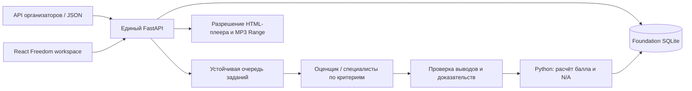

# Архитектура Freedom CQA

## Сценарий

Выбрать диалог → открыть аналитику → проверить критерии и исходные реплики →
при необходимости оспорить критерий → сохранить решение проверяющего.
Импортированные чаты и звонки остаются без оценки до завершения анализа.

`cqa.api:app` — совместимое имя того же `cqa.backend.main:app`, а не второй API.
Foundation хранит записи, версии чек-листа, задания, оценки и append-only историю
проверок. Файлы старого самостоятельного Evaluator сохранены для CLI/benchmark;
они не являются отдельным хранилищем веб-приложения.

## Контракты

- `GET/PUT /api/workspace`: совместимое представление канонических записей;
  оптимистическая ревизия и409 при конфликте двух участников.
- `GET /api/organizer?group_id=DEV`: импорт из серверного источника.
- `POST /api/evaluate?async_job=true`: создать/получить устойчивое задание.
- `GET /api/workspace-evaluations/{job_id}`: состояние и готовый совместимый результат.
- `GET /api/history/{id}`: неизменяемые оценки и их версии.
- `GET /api/conversations/{id}/audio`: настоящий аудиофайл с Range; адрес берётся
  из сохранённого разговора, HTML и внешние подписи не передаются как API-ошибка.
- Полный REST Foundation и `/docs` также доступны; см. `cqa-backend.md`.

Изменение правил создаёт новую версию. Старые оценки и апелляции используют свой
снимок правил. Кэш зависит от входа, правил, модели и стратегии. Балл рассчитывает
код; разрешённые N/A исключаются из знаменателя, критический флаг хранится отдельно.
Отсутствующий результат — неизвестный, а не успешный. Для отсутствия действия
показывается проверенный диапазон вместо выдуманной цитаты. Предварительная оценка
и mock обозначаются в интерфейсе.

## ИИ-роли

`CQA_STRATEGY=two_pass`: общий оценщик + критик.
`CQA_STRATEGY=multi_agent`: специалист для каждого переданного критерия + критик.
Специалисты получают полный диалог и текущие правила; добавление критерия не требует
нового hardcoded агента. Ответы проходят JSON/schema/evidence валидацию; ошибки
провайдера не превращаются в фиктивный завершённый результат.

Одна Ollama может обслуживать роли последовательно; `LLM_CONCURRENCY` ограничивает
нагрузку. На CPU многопроходный анализ заметно медленнее. Наличие нескольких агентов
не доказывает улучшение точности — это проверяется на отдельных Ground Truth.

## Границы работы трёх участников

| Участник | Основные файлы | Ответственность |
| --- | --- | --- |
| Интерфейс | `frontend/src/**`, `frontend/tests/**` | Выбор диалога, аналитика, проигрыватель, формы, UX |
| Backend | `src/cqa/backend/**`, `api/proxy.js`, Compose, deploy | Канонические данные, задания, апелляции, аудио, запуск |
| AI | `src/cqa/service.py`, `prompts.py`, `normalization.py`, `infra/llm/**`, `infra/orchestrator/pipeline.py` | Специалисты, доказательства, scoring, benchmark |

Сначала согласовать поля API; не редактировать одновременно общие Settings,
checklist.json, App.jsx и корневые конфигурации. У каждого отдельная локальная копия;
изменения интегрировать последовательно и проверять совместимость.

## Размещение

Локально FastAPI обслуживает готовый frontend и API на одном origin. Vercel
собирает frontend из корня репозитория и проксирует только разрешённые маршруты
в постоянный HTTPS backend. Durable SQLite и локальная модель не запускаются внутри
Vercel-функции. Backend, подписи API и ключи не включаются в клиентский bundle.
Наличие репозитория или deploy-конфига не доказывает, что удалённый сервис запущен.

## Проверка

Production build, браузерные сценарии выбора/анализа/оспаривания, реальное SQLite
сохранение, очередь/кэш/версии, audio Range и proxy проверяются отдельно. Синтетические
и mock-тесты проверяют программную связку; модельную точность измеряют только на
независимых диалогах с экспертными оценками. Приватные данные не попадают в Git.
