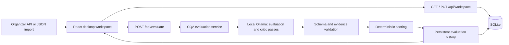

# CQA: architecture and agent responsibilities

## Product flow

A reviewer selects one dialogue, opens its analysis, checks the score and eight versioned checklist results against original messages, and can appeal a specific result. Imported dialogues stay pending until a real evaluator returns a validated result. Dataset averages never replace a dialogue score.

## Runtime boundaries

- `frontend/src/App.jsx`: navigation, user actions, import/export, criterion versions and appeals.
- `SelectionDesk.jsx`: explicit candidate selection and preview.
- `ConversationAnalysis.jsx`: transcript, chronological message navigation, historical criterion results, evidence and appeal entry point.
- `EvaluationPanel.jsx`: real API execution, error/progress/history controls. No simulated evaluator.
- `WorkspaceSync.jsx`: shared workspace API with browser-local fallback.
- `src/cqa/`: service, model provider, validation, deterministic scoring, persistence, CLI and benchmarks.
- Static GitHub Pages deploys the UI. Model execution requires a separately deployed API. The Vite proxy supports local development.

## API and data invariants

`POST /api/evaluate` receives `conversation_id`, `language`, `messages`, `criteria`, `version`, and `force`. Each message retains its original `id`, `role`, `text`, and `time`. A successful result retains its model metadata, checklist version and criterion snapshot, per-criterion answers/reasons/evidence, and calculated score. Errors are shown; pending inputs do not acquire fabricated results.

The other frontend integrations are `GET /api/health`, `GET /api/history/{id}`, and `GET`/`PUT /api/workspace`. Preserve the existing revision/conflict protocol when changing persistence.

Scoring normalizes numeric scales, excludes applicable N/A weights and keeps critical errors as a separate flag. Current rule edits create a new checklist version; existing results use their original snapshot. New rules are configuration, not changes scattered across prompts and UI code. Benchmark accuracy against held-out Ground Truth independently of UI contract tests.

## Parallel ownership for this task

| Agent | Ownership | Deliverable |
| --- | --- | --- |
| Coordinator | This document, integration, git and final review | Integrated branch and reviewable commit |
| API | Read/review `src/cqa/**`, API adapters and contract | Findings on actual request/response and persistence; fixes only if a verified regression needs one |
| Site | `ConversationAnalysis.jsx`, presentation layout review | Faithful light Freedom desktop analysis, preserved backend actions |
| Tests | `frontend/tests/**`, browser QA artifacts | Smoke and API contract checks on integrated code |
| Critic | Read-only final code and screenshots | Prioritized defects and evidence, followed by fixes/retest if necessary |

One agent edits a file at a time. The coordinator owns `App.jsx` during integration; agents must message before changing shared contracts, base styles, root documentation or deployment files. Backend implementation from teammates must be retained. A separate feature branch and PR keep frontend work reviewable.

## Acceptance and review

1. Production frontend builds.
2. Desktop1440/1280 selection → analysis → evidence → appeal → review/recalculation works, without horizontal overflow or JavaScript errors.
3. All eight criteria, historical snapshots, N/A, critical flags and pending states remain correct.
4. Contract tests cover visible service failure and actual payload/result application. These mocks are not an accuracy claim.
5. Inspect screenshots, logo loading, text readability and actionable controls.
6. Review the final diff, resolve critic findings, commit and push. Report PR/deployment status truthfully; a generated URL does not establish successful publication.
