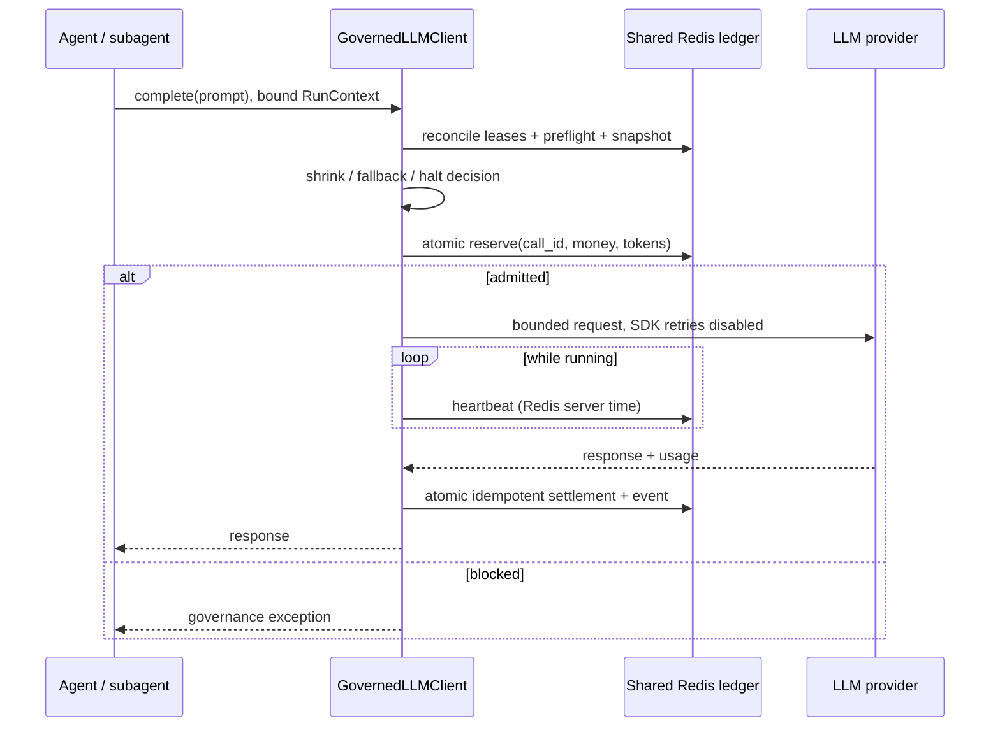
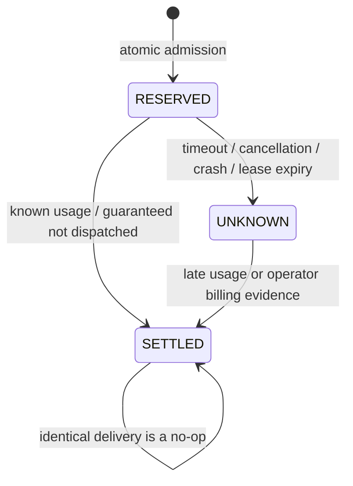

# Архитектура и границы гарантий

## Изученные источники (2026-11-03)

- [Microsoft Command Line: TokenOps](https://commandline.microsoft.com/tokenops-real-time-run-scoped-cost-control-ai-agents/): сквозная атрибуция запуска, разделение решений и применения, STEER перед HALT. В статье явно описаны локальный eventually consistent режим и строгий fail-closed режим общего хранилища.
- [Официальный TokenOps](https://github.com/theagentplane/tokenops): общий ledger, точка контроля перед вызовом, расширяемые политики и адаптеры. Это самостоятельная минимальная реализация паттерна; библиотека TokenOps не скопирована и не является зависимостью.
- [OpenAI Python SDK](https://developers.openai.com/api/reference/python): AsyncOpenAI, отключение автоматических повторов через max_retries=0.
- [Chat Completions](https://developers.openai.com/api/reference/python/resources/chat/subresources/completions/methods/create): max_completion_tokens ограничивает видимые и reasoning-токены вместе.
- [Тарифы](https://developers.openai.com/api/docs/pricing), [GPT-6 Luna](https://developers.openai.com/api/docs/models/gpt-6-luna): отдельные конфигурации реальных и фиктивных цен, Standard/short-context. Наличие модели в аккаунте не проверялось платным запросом.

В отличие от описанного в статье локального режима, здесь каждый допуск проходит Redis Lua. Это добавляет сетевую задержку и зависимость от Redis, но устраняет конкурентное расходование уже зарезервированных средств. Детерминированные политики достаточно малы, чтобы вычислять их синхронно; отдельный управляющий сервис не требуется.

## Поток данных

`RunContext` переносится через contextvars; child() меняет только агентскую атрибуцию. Между процессами передаётся сериализованный контекст доверенных рабочих процессов либо подписанный principal-bound заголовок. Контекст не является источником финансовой истины: Redis хранит лимиты, статус и fingerprint конфигурации. При несовпадении конфигурации процесс не получает допуск.

Ключи `tokenops:{UUID}:run`, `calls`, `events`, `leases`, `progress` попадают в один Redis Cluster slot. Метаданные, учёт, резервы, атрибуция и журнал изменяются одним Lua-скриптом. Клиент использует EVAL, поэтому очистка серверного script cache не влияет на корректность.

## Конкуренция и линейные точки

- В `reserve` проверяются актуальные status, caps, spent+reserved+estimate и token totals. Затем одновременно создаётся call и увеличиваются резервы. Повторный call_id не разрешает повторный dispatch.
- Снимок для PolicyEngine может устареть. `reserve` перепроверяет результат и возвращает RETRY. Остановка из-за недостатка средств выполняется только если revision снимка не изменилась. STEER, установленный другим процессом, также перепроверяется при допуске.
- `settle` переводит RESERVED/UNKNOWN в SETTLED и единожды освобождает резерв. Повтор с теми же money/usage является no-op, несовместимый повтор отклоняется. Для UNKNOWN active уже уменьшен, поэтому повторное завершение не делает счётчик отрицательным.
- Если реальные расходы больше оценки, учитывается вся известная стоимость и включается HALT. Скрывать превышение или обрезать расход по величине резерва нельзя.
- Время lease берётся из Redis TIME. Heartbeat после истечения lease уже не оживляет запрос. Reconciliation обрабатывает до 100 просроченных lease за вызов; вызывайте повторно до возврата 0.

## Жизненный цикл запроса

UNKNOWN сохраняет деньги и token reservation и останавливает новые вызовы. Отдельный lease не является TTL денежного резерва. Живые и HALTED-запуски вообще не имеют TTL; явная архивация разрешена только для COMPLETED/FAILED без незавершённого учёта. Если run всё же удалён оператором/eviction, отсутствующий ledger отклоняет вызовы, а не создаёт новый бюджет.

## Финансовые единицы

Все Redis money fields — целые микродоллары. Python считает тарифы через Decimal и округляет вверх один раз на вызов; доллары на миллион токенов численно равны микродолларам на токен. Зарезервированное число токенов включает input и максимально разрешённый output. Денежный порог STEER рассчитывается через Decimal заранее и передаётся в Lua целым; сравнения денег не используют дробные числа.

Верхние границы конфигурации удерживают обычные операции в точном целочисленном диапазоне Lua. Непредставимое превышение при settlement отклоняется с сохранением резерва и требует внешней сверки; счёт не округляется молча.

## Ограничения

Инвариант `spent + reserved <= budget` обеспечивается для допущенных запросов, когда фактическая стоимость каждого запроса и фактическое число токенов не превосходят резерв. Допуск не может гарантировать, что провайдер соблюдёт оценку или не выставит неизвестную категорию счёта. Тест overrun намеренно показывает отрицательный remaining и HALT.

OpenAI adapter поддерживает один текстовый message и не включает инструменты, изображения, аудио, streaming, automatic retries, Batch или региональные endpoints. Он получает input/output/cache usage из SDK; reasoning уже входит в output и повторно не прибавляется. Для worst-case используется число UTF-8 байтов +64 на framing и верхняя цена входной категории. Это консервативная инженерная оценка, не контрактный предел API. Добавляя tools, RAG с платными embeddings, изображения, аудио или отдельные tool fees, реализуйте их собственные тарифы и допуск до отправки; бесплатные локальные tool steps учитываются через record_step.

Реальные цены могут измениться; конфигурацию надо пересматривать перед production. Ввод ограничен 16K токенами оценки, чтобы не попадать под long-context uplift. Cache writes/read должны быть отражены в usage провайдера; неотражённые категории, налоги, курс валют, тарифные соглашения и региональные надбавки не учитываются автоматически.

SDK/network не обеспечивают exactly-once выполнение запроса. Система обеспечивает идемпотентность ledger и запрещает автоматический повтор сомнительного запроса. Уже допущенный запрос может завершиться после HALT, и его расход всё равно учитывается.

Redis должен быть доверенным, с ACL/TLS, noeviction, резервными копиями и достаточной памятью. Локальный Compose использует AOF appendfsync=always; асинхронная репликация/failover всё равно может потерять подтверждённый допуск. При потере Redis-данных строгая финансовая гарантия прекращается: требуется сверка с провайдером до возобновления. Lua атомарен относительно других клиентов, но runtime-error не откатывает уже исполненные команды; нельзя менять типы ключей или допускать исчерпание ресурсов. Не выдавайте Redis credentials и операторские capability недоверенным агентам.

Журнал и call records сохраняются целиком для аудита и идемпотентности. При долгой эксплуатации архивируйте terminal runs явно; не удаляйте отдельные записи активного запуска ради экономии памяти. Полный публичный HTTP API, multi-tenant identity provider, автоматический запрос счетов провайдера и платный tokenization service в этот пакет не входят.
