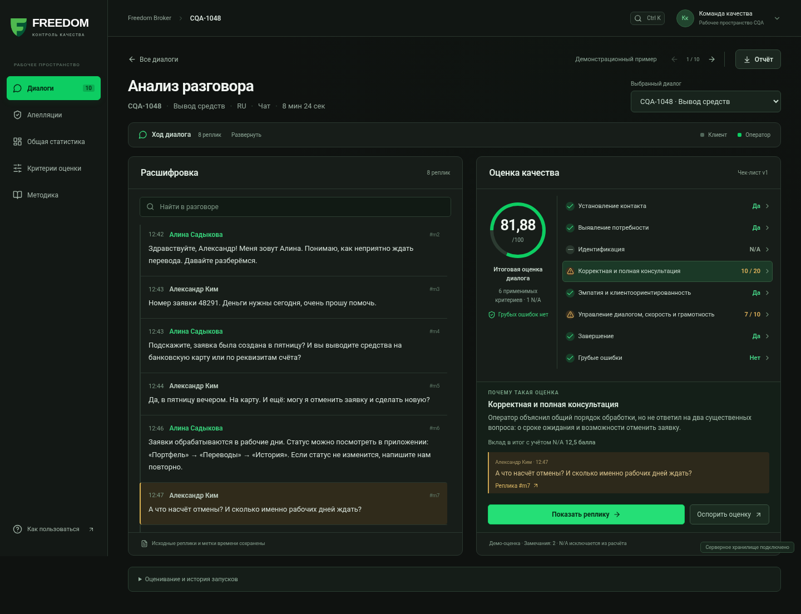

# Freedom CQA



[Conversation selection screen](docs/freedom-selection.png)

[Desktop selection workspace](docs/freedom-selection.png)

Desktop Russian-language frontend for the CQA hackathon. Built with React, Vite and Lucide icons. The presentation redesign is confined to `frontend/`.

## Run

Requires Node.js 20.19+ or 22.12+ (validated with Node 24).

```bash
cd frontend
npm ci
npm run dev
```

Production: `npm run build`. Serve `dist/` using your web server, or use `npm run preview` for local verification.

## Working features

- Dashboard, overview metrics, computed conversation and criterion charts.
- Conversation list with search, language, channel and status filters.
- Transcript next to per-criterion results; evidence links highlight the source message.
- Eight initial checklist criteria from the provided PDF, including scales, N/A and separate critical-error flag.
- Checklist editor and new criteria, with version increments. Existing results retain their original rules.
- Appeal submission and human review; score recalculation retains original answers and score.
- JSON import for the organizers' `data.records` response; imported conversations remain pending evaluation.
- JSON export of checklist, conversations and appeals.
- Labelled desktop forms and keyboard modal focus management.

## Demo boundaries

The UI starts with **synthetic demonstration conversations**, not the organizers' DEV dataset. Analytics charts are computed from the current demonstration evaluations. The Python CQA API now evaluates imported conversations through local Ollama, with a second critic pass and server-side scoring. Start the service using the root README. The standalone static site remains a UI demo. Imported conversations have no evaluation until an API request succeeds. No API keys or signed URLs belong in the frontend.

State is saved in SQLite through the Python API, with a browser-local fallback in localStorage. The server provides shared persistence; static hosting falls back to browser storage. Clear the site's browser storage to reset the demo. Store real conversations and decisions on your backend when connecting the product; review browser retention needs before importing confidential data.

## Backend integration contract

Coordinate any contract change with both the frontend and backend owners. Do not import Python model code into the frontend. The initial view models are in `src/data.js`:

- Conversation: `id`, `customer`, `agent`, `channel` (`chat`/`call`), `language` (`RU`/`KZ`/`EN`), `topic`, `date`, `duration`, `status`, `messages`, `results`, `score`, `critical`, optional `audio_url`.
- Message: `id`, `role` (`client`/`operator`/`bot`/`system`), `text`, original `time`.
- Criterion: `id`, `title`, `description`, `weight`, `type` (`binary`/`scale`/`flag`), `scale`, `naAllowed`, `naCondition`.
- CriterionResult: `criterionId`, `answer`, `reason`, `evidenceId`.
- Existing evaluations may carry `checklistVersion` and `criteriaSnapshot`; resolve appeals against that snapshot, not newly edited rules.

The current local Python service is implemented in `src/cqa/`; UI integration lives in `EvaluationPanel.jsx` and `WorkspaceSync.jsx`. Further backend integrations can use a dedicated client module in `frontend/src/`. Suggested endpoints: conversations, checklist versions, evaluation jobs/results, appeals and review decisions. Backend must preserve full immutable evaluation history, validate all edits and recalculate independently of the browser. For missing actions or N/A, extend the response contract with checked ranges and explicit applicability explanations. Calls need audio-relative timing before implementing seek-to-evidence; the current UI links to original audio if provided.

Scoring normalizes numeric scales, excludes allowed N/A weights, rounds the final result to two decimals and treats critical errors separately. Missing results return an incomplete score, not zero. The frontend calculator is for the prototype and should be verified against the backend implementation.

## Checks

```bash
npm run build
# Start npm run dev in another terminal first:
npm run test:smoke
BASE_URL=http://127.0.0.1:5173 node tests/evaluation.mjs
```

The smoke test uses installed Chromium at `/usr/bin/chromium`. Set `CHROMIUM_PATH` and `BASE_URL` for other environments. It checks scoring, search/filters, evidence navigation, appeal review, checklist persistence, JSON import, modal keyboard dismissal and desktop overflow.

## Three-person Git workflow

| Owner                    | Files                                                                                    | Suggested branch    |
| ------------------------ | ---------------------------------------------------------------------------------------- | ------------------- |
| Frontend                 | `frontend/**`                                                                            | `feat/cqa-frontend` |
| Backend / infrastructure | backend implementation and deployment configuration, excluding `frontend/**`             | `feat/cqa-backend`  |
| AI / evaluation          | evaluator, prompts, criteria configuration and quality fixtures, excluding `frontend/**` | `feat/cqa-ai`       |

Agree on exact backend/AI paths before creating them. The existing `src/tokenops_guard/` package is separate from this new frontend and is unchanged by this PR.

Each person uses their own checkout and branch. Avoid concurrent checkout of different branches inside one shared directory. Edit only your owned paths; coordinate shared API contracts, root README, CI and Compose files before changing them.

```bash
git fetch origin
git switch -c feat/your-task origin/main
# Implement and test your task.
git add path/to/your/files
git commit -m "Describe the implemented feature"
git push -u origin feat/your-task
# Open a PR into main and request a teammate's review.
```

Before merging, fetch main and merge it into your feature branch, resolve conflicts in your own files and rerun affected checks. Use one PR per coherent task. Do not force-push a shared branch. Merge PRs one at a time; cross-directory integration happens through the agreed API contract.

## Freedom design refresh

The UI uses a light green-and-white palette and the existing Freedom shield mark. Roboto is self-hosted, including Cyrillic, so the interface does not depend on Google Fonts. Existing browser-local state migrates from the previous prototype's storage keys.

Charts and criterion summaries now derive from the current evaluations instead of fixed illustration values. The chart selector switches the latest seven evaluations/all evaluations, not an unsupported date filter. New checklist versions do not retroactively change historical results.

Production assets use relative paths, suitable for either a server root or a GitHub Pages repository subpath. The static deployment target is the repository’s GitHub Pages site.

## Primary flow: choose one dialogue

The application starts at a desktop control desk based on the supplied sketch: checklist left, chat selection right, general statistics below, and a selected-dialogue preview. Select a conversation, then click **Открыть аналитику** for its full review. The per-dialogue screen shows its own score, operator, channel, critical flag, criterion profile and evidence-backed findings. It never substitutes the dataset average for the selected dialogue's score.

The dropdown switches the entire analysis to another conversation. `#dialog/<id>` links survive page reload and browser back/forward. A pending imported dialogue has no fabricated score or findings. The **Отчёт** action exports only the selected dialogue and its associated appeals; the list's export includes the dataset. Aggregate statistics remain a separate secondary section.

## Vercel publishing

The Vercel project uses the repository root, root `vercel.json`, `npm --prefix frontend ci --include=dev`, and `frontend/dist`. This keeps the shared checklist JSON available during build. See [deployment instructions](../docs/VERCEL_DEPLOY.md).

The Vercel API proxy uses a fixed trusted HTTPS backend and protected site credentials. Missing configuration returns a truthful503; it never substitutes an HTML page or prepared score. Python/Ollama and durable storage need a separately reachable backend. Credentials and signed organizer URLs never belong in the browser bundle.

## Freedom desktop workspace

The selected visual references are the user's dark Freedom Bank screenshots; the CQA presentation still grounds the workflow. `ConversationAnalysis.jsx` implements the conversation review: actual message chronology, transcript on the left, a computed score and all eight checklist results on the right. Clicking a criterion shows one explanation and a source quote; evidence actions highlight and focus the real message. The timeline represents messages, not a fabricated audio waveform. An audio player appears only when an actual audio URL is present.

The near-black canvas, graphite rail, white Freedom wordmark and vivid green actions follow the selected brand reference. The existing Freedom shield PNG is served locally, including as the favicon; see [asset source](public/freedom-logo-source.md). Roboto is self-hosted and is not claimed to be the official brand font. `presentation.css` defines the review layout, and `freedom-theme.css` supplies the current dark brand colours. Selection and call playback have their own scoped styles.

`SelectionDesk.jsx` owns the explicit choose → open analysis flow. Existing evaluation snapshots, N/A normalization, critical flags, appeals, import/export and backend controls remain connected. Advanced AI execution/history is below the review in a disclosure. No dialogue is preselected on a fresh visit, and pending dialogues never receive invented scores.

The frontend contract test uses mocked model responses to verify the real request shape, visible server errors and applied results. It does not measure model accuracy. See [design verification](design-qa.md) for screenshots and checks.

## Reliability and calls

`tests/reliability.mjs` covers missing/critical results, blocked storage, corrupt stored types, typing focus, JS-load failure, appeals without UUID support and double-submit, organizer loading, phone playback/seek/waveform and numeric ID rejection. The audio fixture is generated PCM, not an organizer recording or an accuracy measurement.

For the complete local frontend+API, run `python scripts/run-cqa.py` from the repository root. This avoids a stale dev process with a missing proxy. Private configuration is `.env.cqa`, ignored by Git.
