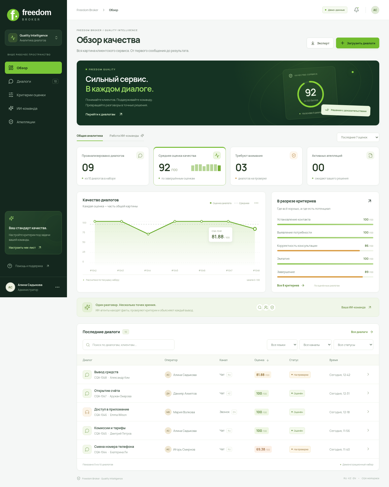

# Freedom Broker · Quality Intelligence



[Mobile preview](docs/freedom-mobile.png)

Responsive Russian-language frontend for the CQA hackathon. Built with React, Vite and Lucide icons. Changes in this PR are confined to `frontend/`.

## Run

Requires Node.js 20.19+ or 22.12+ (validated with Node 24).

```bash
cd frontend
npm ci
npm run dev
```

Production: `npm run build`. Serve `dist/` using your web server, or use `npm run preview` for local verification.

## Working features

- Dashboard, overview metrics, computed conversation and criterion charts.
- Conversation list with search, language, channel and status filters.
- Transcript next to per-criterion results; evidence links highlight the source message.
- Eight initial checklist criteria from the provided PDF, including scales, N/A and separate critical-error flag.
- Checklist editor and new criteria, with version increments. Existing results retain their original rules.
- Appeal submission and human review; score recalculation retains original answers and score.
- JSON import for the organizers' `data.records` response; imported conversations remain pending evaluation.
- JSON export of checklist, conversations and appeals.
- Responsive mobile navigation, accessible labelled forms, keyboard modal focus management.

## Demo boundaries

The UI starts with **synthetic demonstration conversations**, not the organizers' DEV dataset. Analytics charts are computed from the current demonstration evaluations. The application does not call an LLM, run agents, import automatically from a signed URL, or authenticate users. Agent cards explain planned roles. An imported conversation has no generated evaluation. No API keys or signed URLs belong in the frontend.

Browser-local state is saved in localStorage. This is convenient for a prototype, not shared server storage. Clear the site's browser storage to reset the demo. Store real conversations and decisions on your backend when connecting the product; review browser retention needs before importing confidential data.

## Backend integration contract

Coordinate any contract change with both the frontend and backend owners. Do not import Python model code into the frontend. The initial view models are in `src/data.js`:

- Conversation: `id`, `customer`, `agent`, `channel` (`chat`/`call`), `language` (`RU`/`KZ`/`EN`), `topic`, `date`, `duration`, `status`, `messages`, `results`, `score`, `critical`, optional `audio_url`.
- Message: `id`, `role` (`client`/`operator`/`bot`/`system`), `text`, original `time`.
- Criterion: `id`, `title`, `description`, `weight`, `type` (`binary`/`scale`/`flag`), `scale`, `naAllowed`, `naCondition`.
- CriterionResult: `criterionId`, `answer`, `reason`, `evidenceId`.
- Existing evaluations may carry `checklistVersion` and `criteriaSnapshot`; resolve appeals against that snapshot, not newly edited rules.

Connect a backend service through a dedicated client module in `frontend/src/`, replacing local persistence and fixture reads. Suggested endpoints: conversations, checklist versions, evaluation jobs/results, appeals and review decisions. Backend must preserve full immutable evaluation history, validate all edits and recalculate independently of the browser. For missing actions or N/A, extend the response contract with checked ranges and explicit applicability explanations. Calls need audio-relative timing before implementing seek-to-evidence; the current UI links to original audio if provided.

Scoring normalizes numeric scales, excludes allowed N/A weights, rounds the final result to two decimals and treats critical errors separately. Missing results return an incomplete score, not zero. The frontend calculator is for the prototype and should be verified against the backend implementation.

## Checks

```bash
npm run build
# Start npm run dev in another terminal first:
npm run test:smoke
```

The smoke test uses installed Chromium at `/usr/bin/chromium`. Set `CHROMIUM_PATH` and `BASE_URL` for other environments. It checks scoring, search/filters, evidence navigation, appeal review, checklist persistence, JSON import, modal keyboard dismissal and mobile overflow.

## Three-person Git workflow

| Owner                    | Files                                                                                    | Suggested branch    |
| ------------------------ | ---------------------------------------------------------------------------------------- | ------------------- |
| Frontend                 | `frontend/**`                                                                            | `feat/cqa-frontend` |
| Backend / infrastructure | backend implementation and deployment configuration, excluding `frontend/**`             | `feat/cqa-backend`  |
| AI / evaluation          | evaluator, prompts, criteria configuration and quality fixtures, excluding `frontend/**` | `feat/cqa-ai`       |

Agree on exact backend/AI paths before creating them. The existing `src/tokenops_guard/` package is separate from this new frontend and is unchanged by this PR.

Each person uses their own checkout and branch. Avoid concurrent checkout of different branches inside one shared directory. Edit only your owned paths; coordinate shared API contracts, root README, CI and Compose files before changing them.

```bash
git fetch origin
git switch -c feat/your-task origin/main
# Implement and test your task.
git add path/to/your/files
git commit -m "Describe the implemented feature"
git push -u origin feat/your-task
# Open a PR into main and request a teammate's review.
```

Before merging, fetch main and merge it into your feature branch, resolve conflicts in your own files and rerun affected checks. Use one PR per coherent task. Do not force-push a shared branch. Merge PRs one at a time; cross-directory integration happens through the agreed API contract.

## Freedom design refresh

The UI uses a Freedom-inspired green, white and charcoal palette and a typographic Freedom Broker lockup. Manrope is self-hosted, including Cyrillic, so the interface does not depend on Google Fonts. Existing browser-local state migrates from the previous prototype's storage keys.

Charts and criterion summaries now derive from the current evaluations instead of fixed illustration values. The chart selector switches the latest seven evaluations/all evaluations, not an unsupported date filter. New checklist versions do not retroactively change historical results.

Production assets use relative paths, suitable for either a server root or a GitHub Pages repository subpath. Public deployment still needs an explicitly selected hosting target and access.
