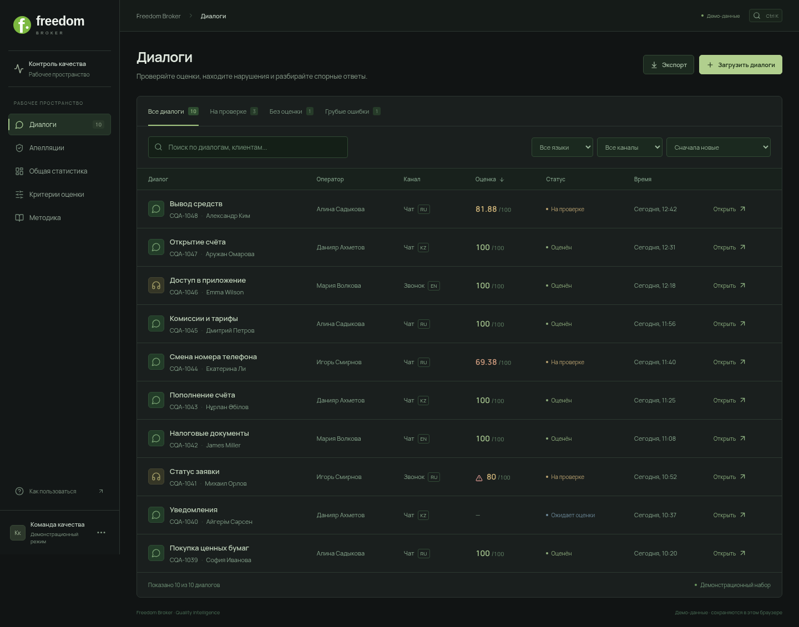
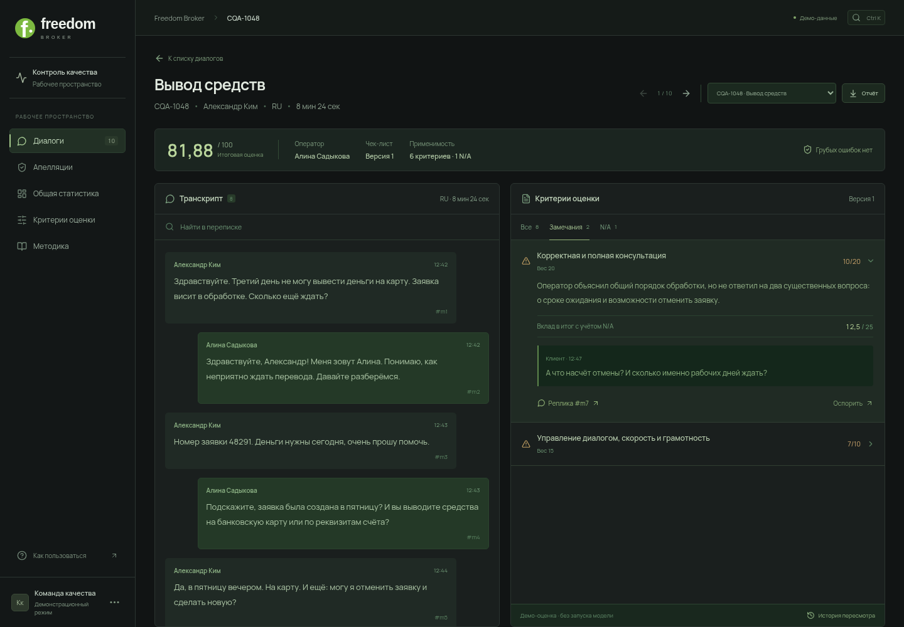
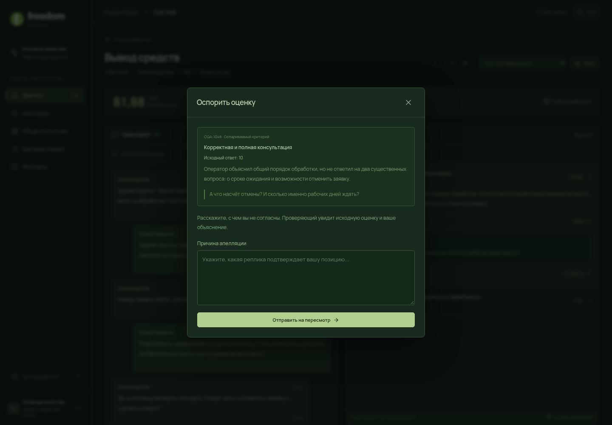

# Пересмотр UX: тёмное рабочее пространство

Цель: сотрудник выбирает диалог, проверяет оценку по исходной переписке и при необходимости оспаривает конкретный критерий. Проверка выполнена на production-сборке в Chromium: 1440×1000 и 390×844.

## Что мешало работе

На исходном экране одни и те же результаты повторялись в профиле критериев, списке замечаний и полной оценке. Карточки занимали место до переписки; на телефоне транскрипт начинался далеко ниже первого экрана. Горизонтальная таблица скрывала оценки и статусы. Форма апелляции требовала помнить контекст предыдущего экрана.

[Исходный экран, зафиксированный перед изменениями](ux-before-review.png)

## Проверенный сценарий

1. **Очередь диалогов — проверено.** Поиск, фильтры языка/канала, вкладки статуса, отдельный фильтр грубых ошибок, сортировка и постраничная навигация. На телефоне карточка сразу показывает тему, балл и статус. Все четыре фильтра помещаются в две строки.
   

2. **Проверка оценки и доказательства — проверено.** Вместо повторяющихся карточек — одна строка результата и две рабочие панели. В критерии раскрываются причина, вклад в итог и цитата. Переход подсвечивает настоящую реплику. На телефоне он переключает вкладку на переписку; поиск подсвечивает совпадения, Enter/Shift+Enter переключают их.
   
   [Мобильная проверка](freedom-mobile.png) · [Мобильная очередь](freedom-mobile-queue.png)

3. **Апелляция и пересмотр — проверено.** В форме видны критерий, исходный ответ, обоснование и цитата. Проверяющий получает этот контекст вместе с комментарием. После решения итог пересчитывается; исходный ответ и реальные записи пересмотра доступны в истории.
   

4. **Изменение правил — проверено.** Редактор сохраняет новую версию; прежняя оценка остаётся связана со своим набором критериев. Числовая шкала, вес и N/A редактируются в общей форме.
   [Редактор чек-листа](freedom-criteria.png)

## Визуальные решения

- Тёмные спокойные поверхности, тонкие разделители и умеренный зелёный акцент Freedom.
- Убраны слоганы, декоративные кольца, баннеры, искусственная активность ИИ и многократное повторение одной оценки.
- Названия экранов и действия соответствуют работе проверяющего. Описание реализации перенесено в краткую методику.
- Все темы собраны в одном `src/styles.css`; старые накладывающиеся стили удалены.
- На компьютере используются независимые области прокрутки; на телефоне — вкладки, без горизонтальной таблицы для основной задачи.

## Проверки и пределы

`npm run build` и `npm run test:smoke` прошли. Smoke-проверка включает формулу/N/A/грубый флаг, сортировку, фильтры очереди и критериев, отчёт выбранного диалога, доказательства, апелляцию и пересчёт, версии правил, импорт, Escape, мобильные карточки и переход между вкладками. Ошибок JavaScript и горизонтального переполнения на 390 px не обнаружено.

Это проверка интерфейса и перечисленных взаимодействий, а не заявление о полной доступности по WCAG. Полная проверка скринридером и на реальных мобильных устройствах не проводилась. Оценки демонстрационные; подключение реальной модели и общей серверной базы остаётся отдельной интеграцией. Публичная публикация зависит от включённого GitHub Pages в репозитории.
